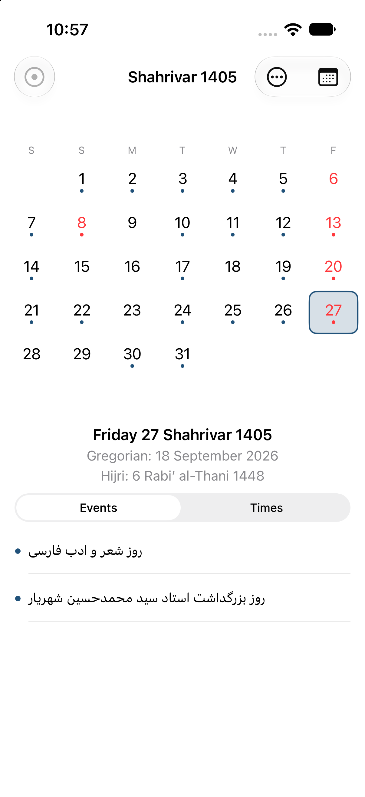

# Persian Calendar for iOS

A native SwiftUI port of the Android [Persian Calendar](https://github.com/persian-calendar/persian-calendar):
Jalali (Shamsi), Hijri and Gregorian dates side by side, with holidays and events, prayer times,
qibla, and the astronomy extras.



Swift 6 · SwiftUI · iOS 17+ · iPhone only · **117 tests passing** · GPL-3.0-or-later

## Status

The port is feature-complete and runs on the simulator in Persian, English and Arabic, in light
and dark mode, including at accessibility text sizes. Every screen of the Android app that has an
iOS equivalent is here; the Android-only surfaces (widgets, Wear OS, live wallpaper, quick-settings
tile) are not.

## Features

- **Calendar** — month pager with a day-details pane, holidays and events, prayer times, go-to-date
- **Year / Month / Week** views, each a different lens on the same data
- **Converter** — date conversion, distance, and a full expression calculator with QR output
- **Compass** — qibla direction from CoreLocation, true and magnetic north
- **Level** — bubble level from CoreMotion
- **Astronomy** — moon phase, zodiac, seasons, rise/set, animal year, and an astrological chart
- **Map and globe** — equirectangular map and draggable orthographic globe, both with the day/night
  terminator, time zones, tectonic plates and qibla
- **Settings** — interface language, calendar types, location picker, prayer-time method, holidays,
  shift work
- **Device calendar integration** — read your EventKit events into the day view
- **Athan reminders** — local notifications built from the app's own prayer-time calculation

## Requirements

- macOS with Xcode and an iOS 17 or later SDK (the port was developed against Xcode 27 beta)
- A simulator named **iPhone 17** — this is `build.sh`'s default; pass `DEVICE="iPhone Air"` (or any
  installed simulator) to use another. `xcodebuild` needs the same destination.

`build.sh` finds Xcode itself: it tries `DEVELOPER_DIR`, then `/Applications/Xcode.app`, then
`/Applications/Xcode-beta.app`, then `xcode-select -p`. You only need to set `DEVELOPER_DIR`
yourself if none of those are right.

## Build, test, run

```sh
cd ios-app

./build.sh                 # build for the simulator
./build.sh test            # build and run the full test suite (117 tests)
./run.sh                   # build, install and launch on the simulator
./run.sh --shot shot.png   # ...and capture a screenshot
./make-ipa.sh              # unsigned arm64 .ipa -> ../ipa/PersianCalendar.ipa
```

Or drive Xcode directly — the scheme is shared, so a fresh clone works:

```sh
cd ios-app
xcodebuild -scheme PersianCalendar \
  -destination 'platform=iOS Simulator,name=iPhone 17' build
```

Opening `ios-app/PersianCalendar.xcodeproj` in Xcode and pressing Run works too. To run on a
physical iPhone, pick your team under Signing & Capabilities first.

## Downloads

[Releases](https://github.com/soso645/persian-calendar-ios/releases) carries a pre-built
`PersianCalendar.ipa` (1.4 MB, arm64, **unsigned**). iOS will not install it as-is — it has to be
re-signed for your device with Sideloadly, AltStore/SideStore, or Xcode. `ipa/README.md` has the
step-by-step.

## Repository layout

| Path | What it is |
|---|---|
| `ios-app/` | The Xcode project — app target, tests, resources, build scripts |
| `ios-app/PersianCalendar/Core/` | Pure logic: calendar conversion, prayer times, calculator, QR, astronomy |
| `ios-app/PersianCalendar/Data/` | Settings, event repository, athan scheduling, language bundles |
| `ios-app/PersianCalendar/UI/` | Screens, one directory per screen |
| `ios-app/PersianCalendarTests/` | XCTest suite, largely ported from the Android unit tests |
| `port-reference/` | The upstream Kotlin libraries and `events.json` the port was checked against |
| `ipa/` | IPA packaging notes (the binary itself is a release asset, not tracked) |

## Implementation notes

A few things that are not obvious from the source:

- The astronomy engine is the **vendored C library** from [cosinekitty/astronomy](https://github.com/cosinekitty/astronomy)
  (v2.1.19, the exact commit the Android app pins), wrapped in `Core/Astronomy/Astronomy.swift`.
  Hand-retyping 10,000 lines of ephemeris coefficients would have been a fidelity risk, not a win.
- `events.json` is parsed at runtime rather than code-generated, so the data file stays the single
  source of truth.
- The globe is drawn with `Canvas` from projected coastline paths, not with a shader — same
  picture, no Metal pipeline to maintain.
- Runtime language switching swaps `Bundle.main`'s class (`Data/LanguageBundle.swift`), because
  SwiftUI resolves `LocalizedStringKey` through the process bundle, which is why the bundle itself
  is swapped rather than the environment locale changed.

## License

GPL-3.0-or-later. This is a derivative work of the Android Persian Calendar, which is licensed under
the GNU GPL v3 or later, so the port carries the same licence — see [LICENSE](LICENSE).

Third-party components (the reference libraries, the astronomy engine, the QR encoder, the event
data and the athan recordings) are credited with their own licences in [ATTRIBUTION.md](ATTRIBUTION.md).

Not affiliated with or endorsed by the upstream project or its authors.
